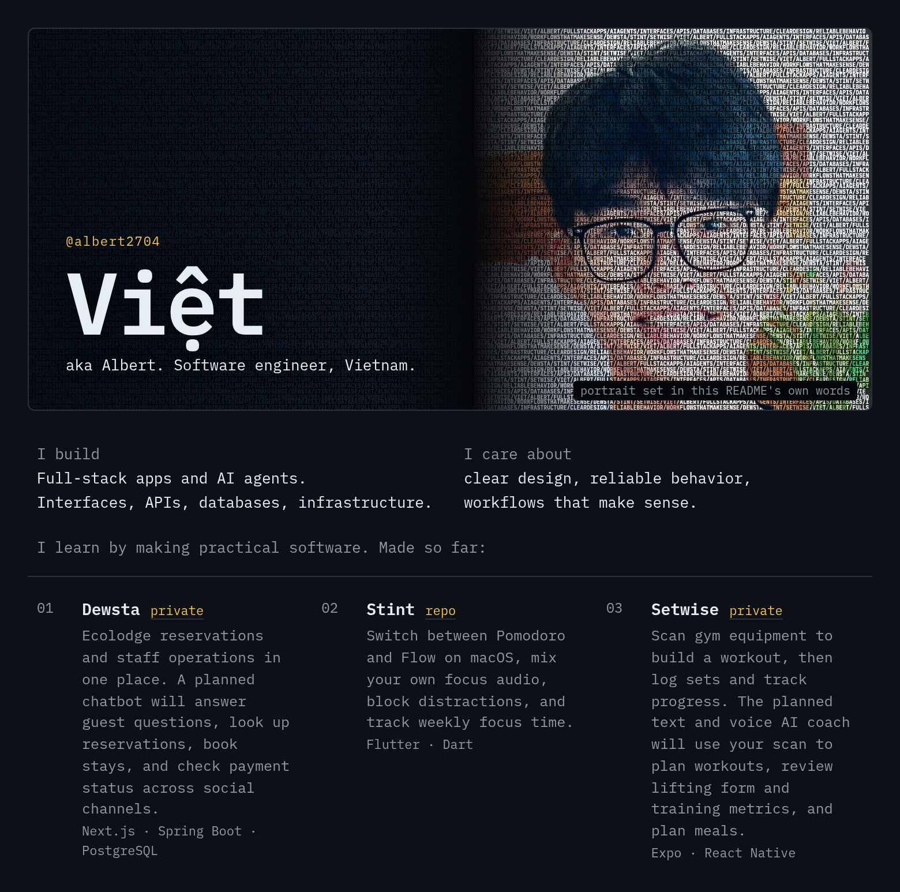

<picture>
  <source media="(max-width: 900px)" srcset="./assets/profile-mobile.png">
  
</picture>

[Stint repository](https://github.com/albert2704/stint) · [Facebook](https://facebook.com/albert2704) · [Email](mailto:albert04.dev@gmail.com)

Read the profile as text

I'm Việt, also known as Albert. I'm a software engineer in Vietnam.

**I build** full-stack apps and AI agents, from interfaces and APIs to databases and infrastructure.

**I care about** clear design, reliable behavior, and workflows that make sense. I learn by making practical software.

## Projects

### Dewsta

Ecolodge reservations and staff operations in one place. A planned chatbot will answer guest questions, look up reservations, book stays, and check payment status across social channels.

*Private project · Next.js · Spring Boot · PostgreSQL*

### [Stint](https://github.com/albert2704/stint)

Switch between Pomodoro and Flow on macOS, mix your own focus audio, block distractions, and track weekly focus time.

*Flutter · Dart*

### Setwise

Scan gym equipment to build a workout, then log sets and track progress. The planned text and voice AI coach will use your scan to plan workouts, review lifting form and training metrics, and plan meals.

*Private project · Expo · React Native*

