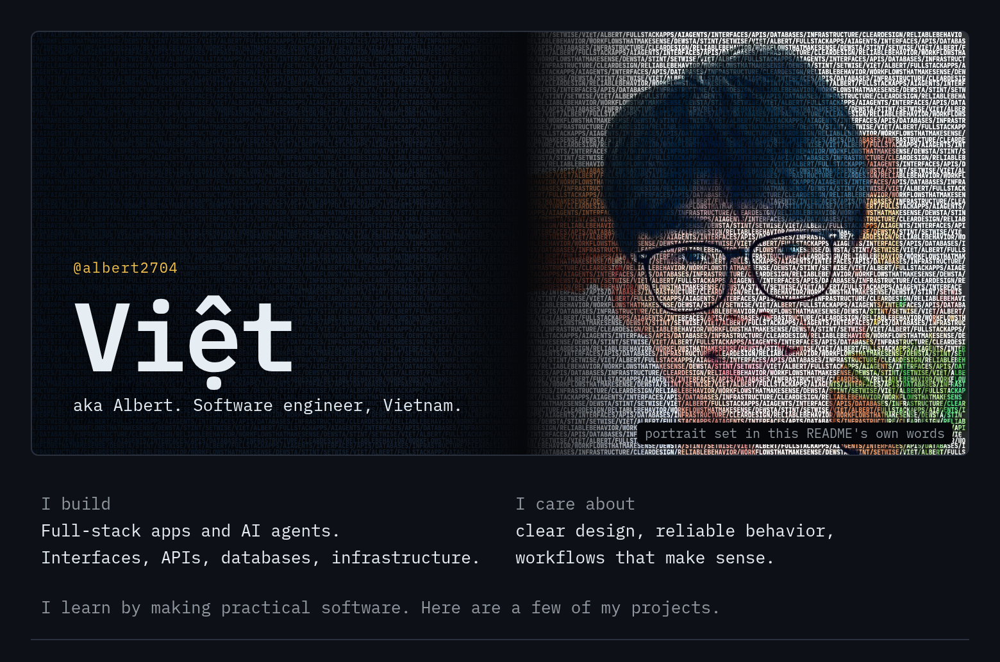
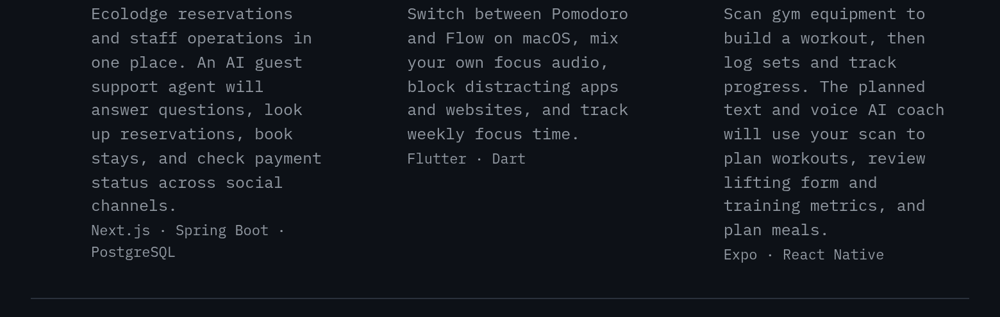

<picture><source media="(max-width: 900px)" srcset="./assets/profile/mobile-intro.png"></picture>

<picture><source media="(max-width: 900px)" srcset="./assets/profile/mobile-project-left.png"></picture><a href="https://github.com/albert2704/stint"><picture><source media="(max-width: 900px)" srcset="./assets/profile/mobile-stint.png"></picture></a><picture><source media="(max-width: 900px)" srcset="./assets/profile/mobile-project-right.png"></picture>

<picture><source media="(max-width: 900px)" srcset="./assets/profile/mobile-project-details.png"></picture>

<picture><source media="(max-width: 900px)" srcset="./assets/profile/mobile-contact-left.png"></picture><a href="https://facebook.com/albert2704"><picture><source media="(max-width: 900px)" srcset="./assets/profile/mobile-facebook.png"></picture></a><a href="mailto:albert04.dev@gmail.com"><picture><source media="(max-width: 900px)" srcset="./assets/profile/mobile-email.png"></picture></a><picture><source media="(max-width: 900px)" srcset="./assets/profile/mobile-contact-right.png"></picture>

